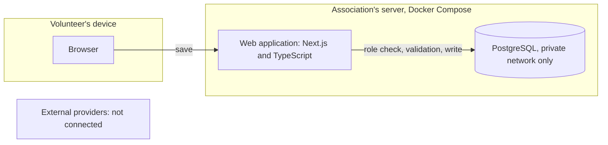

# Architecture

This page describes a proposed design. Nothing has been built. Every control on this page is planned and has not been implemented or tested. The technology choices are proposals and are open to review.

## Components and data flow

The proposal is a single self-hosted workspace for one association. A person works in the browser, and changes are sent only when they save. The application, written in Next.js and TypeScript, first checks that the person belongs to the workspace and has the right role. The input is then validated against a shared Zod schema and written to PostgreSQL through Prisma. Gaps, such as a service without a deputy, are worked out from the stored records and recalculated when a record changes.

## Trust boundaries

- Between the browser and the application: everything that arrives from the browser, including imported files, is treated as untrusted and checked on the server.
- Between the application and the database: the database is reachable only from the application, on a private network.
- Between the register and external providers: there is no connection. The register does not sign in to a provider, read from it or change anything there.

## Roles and permissions (planned)

| Role | Can do |
|---|---|
| Administrator | Manage members and make full exports |
| Coordinator | Create and manage handovers |
| Reviewer | Comment and receive a report limited to the records under review |
| Observer | Read assigned records only |

A reviewer's report is not the same as a full database export.

## Allowed data

For the [scenarios](scenarios.md) S1 to S3, the register stores only:

- who holds a role and who is the deputy
- the category of a service
- the review state and dates
- a reference to a public provider procedure, or to the person who looks after an internal guide

For social media and payment accounts, the register records that permissions were reviewed. It does not record the permissions themselves.

## Prohibited data

- passwords, recovery codes, tokens and private keys
- payment details
- budgets, member lists and document contents
- private sharing links

Fields are planned to be checked in the interface, in the API and during import, before anything is stored. Pattern matching, for example with regular expressions, can catch some secrets, but it cannot guarantee that free text contains none.

## Audit history

Audit events keep an agreed set of details about each change, not full copies of a record before and after the change. Retention periods for audit events, exports and backups have to be set before a pilot.

## Operations (planned)

- Docker Compose runs the web service and the database as separate services. The database is not reachable from outside.
- Secrets needed to run the application, such as the database password, are kept outside the repository and outside the service records.
- The register's own sign-in stores password hashes for its users. These are separate from the credentials of the association's services, which the register never stores.
- Tracking is switched off by default.

## Planned tests

- A user cannot open records outside their role.
- Rejected input does not appear in logs.
- A backup can be restored.
- Deleted records are removed after the agreed period.

## Operational risks

- Someone types a secret into a free-text field.
- A full export or a backup is kept somewhere unsafe.
- The audit history keeps data that should have been deleted.
- A reviewer or observer sees records outside their assignment.

## Open questions

- Which role may read, edit, export and delete each kind of record?
- What is the smallest useful audit history?
- Which fields could accidentally contain secrets?
- How are private sharing links detected and rejected?
- Where do exports and backups go?
- How do deletion and audit retention fit together?

Answers will be recorded as architecture decisions.

[Back to README](../README.md)
